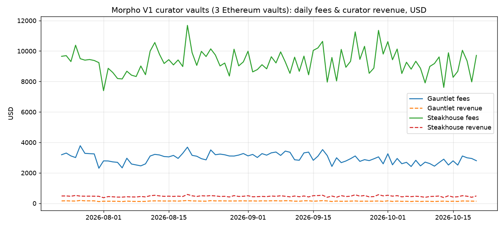

# Morpho curator vault fees

Daily **fees, supply-side fees and revenue (USD)** for three MetaMorpho V1 curator vaults on Ethereum (Steakhouse USDC, Steakhouse ETH, Gauntlet USDC Prime). Metric definitions follow Token Terminal's: fees = revenue + supply-side fees. See [METHODOLOGY.md](METHODOLOGY.md).



## Pipeline
```
public RPC logs + archive eth_call ─┐
DefiLlama daily prices ─────────────┴─> dbt seeds ─> raw ─> decoded ─> normalised ─> metrics ─> export (dashboard/data, reports/)
```
- `scripts/backfill_rpc.py`: events (`AccrueInterest`, `Deposit`, `Withdraw`), vault settings, day-end `lastTotalAssets` snapshots, prices
- `dbt/`: dbt-duckdb project. Models: `vault_interest_accruals`, `vault_events_ledger`, `vault_fees_daily`, `curator_fees_daily`
- Tests: fees = revenue + supply-side (exact); the event ledger equals on-chain `lastTotalAssets()` at every day-end block (independent RPC reconciliation); one row per vault per day; a price on every row
- `scripts/blue_fee_check.py`: checks that the Morpho Blue protocol fee is 0 (SetFee events + `market(id).fee`)
- `sql/`: the same raw layer for Dune (`ethereum.logs`, `prices.day`), with `scripts/dune.py` to run it (needs `DUNE_API_KEY` in env; never commit it)

## Run
```bash
python3 -m venv .venv && .venv/bin/pip install -r requirements.txt
./run.sh 2026-10-20 90 2026-10-19      # end day, number of days, reconciliation day
```
Outputs: `morpho.duckdb`, `reports/curator_fees_daily.png`, `reports/reconciliation_<day>.{csv,md}`, `dashboard/data/*.json`.

## Dashboard
A static site in `dashboard/` (plain HTML + Chart.js from a CDN, no build step, no secrets). Local: `cd dashboard && python3 -m http.server`.
Vercel: `vercel.json` sets `outputDirectory: dashboard` with no build step (or set Root Directory = `dashboard`, Framework = Other).
